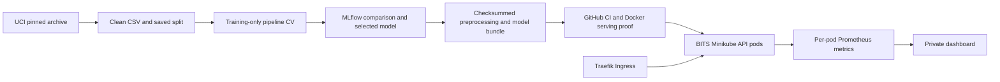

# Heart Disease Prediction — MLOps Assignment 1

This repository contains an end-to-end MLOps assignment using the UCI processed Cleveland heart-disease dataset.

Repository: <https://github.com/2025ae05568-rkmishra/mlops-assignment1>

> **Submission workflow:** Its using Minikube cluster for deployment which can be done locally or in any cloud provider. Assignment was done in BITS so to follow the BITS deployment and access sequence below:

**Final submission:** [Ten-page BITS report](output/pdf/2025ae05568-mlops-final-report.pdf), [validated VM evidence and selected screenshots](reports/evidence/bits/README.md), [local API access instructions](reports/evidence/bits/reviewer-access.md), and the separately submitted `2025ae05568-mlops.mp4`. The report uses release run **39107510102**.

## Fast path: deploy on a Rocky Linux 9 BITS lab VM

The deployment installs Traefik from repository Kubernetes manifests when no controller exists; it does not depend on the Minikube Traefik addon or require a Minikube upgrade. Existing controllers are reused.

The GitHub release workflow builds and smoke-tests the AMD64 application image. The VM downloads that image and runs it in Minikube; it does not need to train or build the model locally.

### Before starting

Use a Rocky Linux 9 **x86_64/AMD64** VM with:

- Git available to clone the repository, and Docker running and usable by your regular account.
- Minikube installed; enough VM resources for a 4-CPU, 6-GiB Minikube profile.
- Network access to GitHub Actions artifacts, Python package downloads, and container registries.
- An account with `sudo` access for the bootstrap, plus GitHub access to dispatch workflows and download artifacts.
- A desktop/browser on either the VM or your workstation for reviewing the dashboard and recording the video. Video recording is manual; it is not a Kubernetes component.

### Run in this order

For an existing checkout, use `cd ~/workspace/mlops-assignment1`, `git switch main`, and `git pull --ff-only` instead of cloning again. To view an already-working deployment, go directly to the access section below. The commands use `.venv/bin/python` explicitly, so activating the virtual environment is optional.

1. **Clone the new repository and enter it.**

   ```bash
   mkdir -p ~/workspace
   cd ~/workspace
   git clone https://github.com/2025ae05568-rkmishra/mlops-assignment1.git
   cd mlops-assignment1
   git switch main
   git pull --ff-only
   ```

   Run the scripts from this checkout. They require a clean worktree on the pushed `main` commit. If you make documentation or code changes, commit and push them before running the end-to-end deployment script.

2. **Prepare the VM, Python environment, Minikube, and Prometheus.**

   ```bash
   bash scripts/bootstrap_rocky9.sh --skip-installed
   ```

   Run as your regular user, **not** with `sudo`. This installs missing host tools (including Python 3.11, `kubectl`, and GitHub CLI), starts/checks the `mlops-assignment` Minikube profile, installs a `kubectl` client matching the cluster, applies and waits for the in-cluster Prometheus deployment, and runs `make setup` to install the locked Python, dashboard, and report dependencies. It does **not** build or deploy the assignment application image. The timestamped log is in `~/mlops-bootstrap-logs/`.

   If only Prometheus needs applying to an already-running cluster, use this instead:

   ```bash
   bash scripts/bootstrap_rocky9.sh --prometheus-only
   ```

   This mode installs no host software, does not start Minikube, and does not set up the Python environment. It is optional: the deployment script also applies Prometheus.

3. **Authenticate GitHub CLI.**

   ```bash
   gh auth login --hostname github.com --web
   gh auth status --hostname github.com
   ```

   Complete browser sign-in with an account that can run Actions and download artifacts for this repository.

4. **Build on GitHub Actions, then deploy and test on the VM.**

   ```bash
   bash scripts/run_lab_deployment.sh
   ```

   Before repeating deployment, stop any existing `open_vm_access.sh` session with Ctrl-C so ports 8081 and 9090 are available for the runner's checks.

   This one command checks the checkout and cluster, dispatches the **Package verified local-deployment release** workflow on GitHub, waits for its training/tests/image smoke test to succeed, downloads and checksum-verifies its image artifact, loads the image into Docker, deploys the API and Prometheus to Minikube, exercises valid and invalid API requests through Traefik Ingress, checks that `/metrics` is not publicly routed, and collects deployment evidence. It prints the workflow run ID and link when complete. Detailed logs and captured runtime evidence are under `reports/evidence/runtime/`.

   For a replacement VM, use a clean **main** checkout at the **same commit as current remote main**, and reuse a successful **release workflow** run for that commit:

   ```bash
   bash scripts/run_lab_deployment.sh --reuse-run RUN_ID
   ```

   This downloads the existing artifact instead of starting a new build. GitHub retains release artifacts for 90 days. Do not use a CI run ID as the release run ID. The checkout, remote main and release commit must all match. Run `39107510102` belongs to the archived submission evidence; after main advances, use the default deployment command to build a new release.

5. **Check the result.**

   ```bash
   minikube -p mlops-assignment status
   kubectl --context mlops-assignment -n mlops-assignment get pods,svc,ingress
   kubectl --context mlops-assignment -n mlops-assignment get deployment/prometheus
   ```

   Wait for two API replicas and Prometheus to be ready. The runner already tests prediction via Ingress. For persistent private access, run `bash scripts/open_vm_access.sh` on the VM and follow the access section below.

### Traefik controller installation

Step 4 calls `scripts/deploy_minikube.sh`, which automatically installs `deploy/traefik/controller.yaml` if `kube-system/traefik` is absent. The manifest supplies the controller's service account, RBAC, IngressClass `traefik`, Deployment and LoadBalancer Service on HTTP port 8081. The script waits for readiness before applying the application Ingress. No separate controller installation is needed in the normal sequence.

To install the controller manually in an already-running `mlops-assignment` cluster, run these from the repository root:

```bash
kubectl --context mlops-assignment apply -f deploy/k8s/base/namespace.yaml
kubectl --context mlops-assignment apply -f deploy/traefik/controller.yaml
kubectl --context mlops-assignment -n kube-system rollout status deployment/traefik --timeout=300s
kubectl --context mlops-assignment get ingressclass traefik
kubectl --context mlops-assignment -n kube-system get svc traefik
```

Continue with the normal deployment command after the controller is ready. Existing controllers are reused; manual installation is an alternative to the automatic step. Keep the installed Minikube 1.35 and Kubernetes/kubectl 1.32 used on BITS.

### Open the deployed API, dashboard and MLflow

After `bash scripts/run_lab_deployment.sh` finishes successfully, run this **on the BITS VM**, from the repository directory:

```bash
bash scripts/open_vm_access.sh
# Equivalent: make vm-access
```

Keep this terminal running while reviewing, taking screenshots or recording the video. The script starts the Traefik API port-forward, internal Prometheus port-forward, monitoring dashboard and a view of the downloaded release's MLflow experiments. Do not also start `make dashboard`, `make mlflow` or separate forwards on these ports; stop any existing ones before running this script.

| View | Open on the BITS VM desktop |
|---|---|
| Monitoring dashboard | http://127.0.0.1:8090 |
| Selected release's MLflow experiments | http://127.0.0.1:5000 |
| API through Traefik Ingress | http://127.0.0.1:8081 with `Host: heart-disease.test` |

In a **second VM terminal**, enter the same repository directory, then test prediction and generate dashboard traffic. For the demonstrated VM checkout:

```bash
cd ~/workspace/mlops-assignment1
.venv/bin/python scripts/smoke_api.py --url http://127.0.0.1:8081 --host heart-disease.test
.venv/bin/python scripts/generate_traffic.py --duration 60
```

The smoke test sends valid and invalid requests. Open the dashboard during traffic generation and allow at least two scrapes before capturing graphs. For browser API docs, map `heart-disease.test` to `127.0.0.1` on the viewing machine and open http://heart-disease.test:8081/docs; plain localhost requests do not match the Ingress host rule.

If viewing from your workstation instead of the BITS desktop, keep the VM script running and open a **workstation terminal**:

```bash
ssh -N -L 8081:127.0.0.1:8081 -L 8090:127.0.0.1:8090 -L 5000:127.0.0.1:5000 USER@VM
```

Replace `USER@VM` with your actual BITS SSH destination and use its required VPN/jump host, if any. Then open the same dashboard and MLflow URLs on your workstation. This step is unnecessary when using the BITS VM desktop directly.

Press **Ctrl-C** in the VM script terminal to stop its access processes. The Kubernetes deployment remains running. Troubleshooting logs are under `reports/evidence/runtime/access/`.

### Capture evidence and submit the report

The deployment runner automatically calls `scripts/capture_submission.py`; you do not normally run it manually. Find the selected evidence directory with:

```bash
cat reports/evidence/runtime/latest-submission.txt
```

Add current-release screenshots (`ci.png`, `ci-artifact.png`, `mlflow.png`, `deployment.png`, `monitoring.png`) to that directory's `screenshots/` folder, and add your demonstrated access instructions as `reviewer-access.md`. The selected submission evidence has already been transferred to `reports/evidence/bits`.

The completed ten-page report is provided at `output/pdf/2025ae05568-mlops-final-report.pdf`. Submit that PDF and the separately exported recording. A hosted video link is optional when the video is submitted as a file. The evidence directory contains the metrics, figures, deployment checks and screenshots supporting the report.

| New script | When it runs |
|---|---|
| `scripts/open_vm_access.sh` | You run it after successful deployment; keep its terminal open. |
| `scripts/capture_submission.py` | Called automatically by `scripts/run_lab_deployment.sh` to capture and validate release/VM evidence. |
| `scripts/serve_release_mlflow.py` | Called automatically by `scripts/open_vm_access.sh` to show the downloaded release's experiments. |

The screenshots should show the successful release job and downloadable artifact, selected MLflow parameters/metrics/artifacts, ready Kubernetes resources with valid/invalid Ingress responses, and a populated dashboard with both targets UP. Export evidence before stopping or replacing the VM; monitoring history is ephemeral. Package it from the VM repository root with `tar -czf ~/bits-evidence.tgz reports/evidence/runtime`. The copied runtime pointer contains a VM-specific absolute path; inspect the extracted snapshot directly on the Mac. A later deployment creates its own evidence and does not change the release documented in the submitted PDF.

### Pipeline video

The completed recording is `2025ae05568-mlops.mp4` (approximately 68 MB; 11 minutes 13 seconds), submitted separately. It covers the repository, successful CI and release artifact, MLflow results, Kubernetes/Ingress checks, monitoring and request logs. Keep the original MP4 locally; if using a hosted link, verify evaluator access. The recorded screen and both narration segments are already combined in this export.

### Deployment troubleshooting

For a controller failure, inspect `kubectl --context mlops-assignment -n kube-system logs deployment/traefik --tail=50`. For application failures, inspect `kubectl --context mlops-assignment -n mlops-assignment get events --sort-by=.lastTimestamp` and `kubectl --context mlops-assignment -n mlops-assignment logs -l app=heart-disease-api --prefix --tail=50`. Keep comma-separated resource types together as `pods,svc,ingress`.

Ingress `/ready` and `/predict` need `Host: heart-disease.test`. HTTP 422 for deliberately invalid input and HTTP 404 for Ingress `/metrics` are expected. HTTP 503 requires checking pod/model readiness. Access failures are logged under `reports/evidence/runtime/access/`; stop the previous access process before reusing its ports. Generate traffic and allow at least two scrapes before expecting populated monitoring graphs. The release access script needs its VM runtime pointer and full downloaded release directory, including MLflow data; the committed report snapshot alone does not supply those live-access dependencies.

## Run the data, training, and test pipeline

Use Python 3.11 and the repository's locked requirements:

```bash
make setup
make verify
```

`make verify` runs lint, data acquisition, EDA, model comparison/training, model packaging, and unit/integration tests. To run individual stages:

```bash
make data
make eda
make train
make package
make test
```

The dataset archive and its member are SHA-256 pinned in `data/manifests/source-lock.json`. `make data` downloads the source if it is not cached, verifies its hashes, creates the cleaned dataset and deterministic split manifest, and fails if the upstream data changes. Do not silently regenerate the source lock.

Preprocessing is part of the fitted cross-validation pipeline: median imputation for numeric features, mode imputation and one-hot encoding for categorical features, and scaling for Logistic Regression. A stratified 80/20 split and five shared training-only folds use seed 42. The search compares a DummyClassifier, six Logistic Regression configurations, and eighteen Random Forest configurations; model selection uses mean CV ROC-AUC with a 0.01 simplicity rule favoring Logistic Regression. The 0.5 threshold is fixed. Held-out test results do not drive tuning. See [training configuration](configs/training.yaml), [selected model manifest](reports/evidence/bits/manifest.json), [selected BITS metrics](reports/evidence/bits/metrics/), and [selected BITS figures](reports/evidence/bits/figures/).

New runs regenerate `reports/metrics/`, `reports/figures/` and runtime evidence as ignored working outputs. Submission results are preserved separately in `reports/evidence/bits/`; older Mac-generated results are excluded.

MLflow records candidate parameters, metrics, artifacts, plots, and lineage in `mlflow.db` and `mlruns/`. The selected full preprocessing/model pipeline is packaged with checksums and schema information under `artifacts/model/`; those generated model and tracking files are git-ignored and should be exported when needed for durable evidence.

To browse the local experiment runs, start MLflow and open its URL:

```bash
make mlflow
# Open http://127.0.0.1:5000
```

## Local development (macOS or Linux)

Install Python 3.11, Git, Docker, kubectl, and Minikube first (on macOS, install Docker Desktop separately and start it). Then run the pipeline commands above. To deploy a locally built image to Minikube instead of using the BITS lab release flow:

```bash
make docker-build
make docker-smoke
minikube start -p mlops-assignment --driver=docker --cpus=4 --memory=6144
make deploy-minikube
```

`make docker-build` packages the current local model, so train/package first if no verified model bundle is present. A locally built deployment does not create a downloaded GitHub release or its runtime pointer; use the manual access sequence below rather than `scripts/open_vm_access.sh`.

After `make deploy-minikube`, open three separate terminals in the repository directory and keep each command running:

```bash
# Terminal 1: forward to the Traefik controller, preserving Ingress routing.
kubectl --context mlops-assignment -n kube-system port-forward --address 127.0.0.1 svc/traefik 8081:8081
```

```bash
# Terminal 2: private Prometheus access for the dashboard.
kubectl --context mlops-assignment -n mlops-assignment port-forward --address 127.0.0.1 svc/prometheus 9090:9090
```

```bash
# Terminal 3: private dashboard at http://127.0.0.1:8090.
make dashboard
```

In a fourth repository terminal, run:

```bash
.venv/bin/python scripts/smoke_api.py --url http://127.0.0.1:8081 --host heart-disease.test
.venv/bin/python scripts/generate_traffic.py --duration 60
```

Start `make mlflow` separately for this local training run's experiments at http://127.0.0.1:5000. This controller Service port-forward exercises the Ingress rules without requiring `minikube tunnel`. Stop the forwards/dashboard with Ctrl-C when finished.

## API and Docker

The FastAPI service loads the verified packaged pipeline; requests do not trigger training. To run locally after packaging:

```bash
make serve
```

In another terminal:

```bash
make smoke
```

API docs: <http://127.0.0.1:8000/docs>. `POST /predict` accepts the synthetic request in `tests/fixtures/valid_request.json` and returns the class, positive-class probability, confidence for the returned class, threshold, and model/schema versions. All 13 fields are required; only `ca` and `thal` may explicitly be null. Invalid input receives a sanitized HTTP 422 response.

Confidence is `p` for a positive prediction and `1-p` for a negative prediction. Extra or missing fields, unknown category codes, numeric strings, Boolean substitutions and nonfinite numbers are rejected. Bodies larger than 16 KiB receive HTTP 413; an unavailable verified model receives 503. `/health` checks process liveness, `/ready` verifies model readiness, `/version` reports serving identity, and `/metrics` is internal-only. A request ID ties responses to structured logs.

Build and test an isolated container after packaging:

```bash
make docker-build
make docker-smoke
```

The Docker image contains the selected model and runs as UID 10001 with a read-only root filesystem and writable `/tmp`. The GitHub workflows also verify the model, tests, container build, and container smoke test.

## Architecture



The API uses the fitted preprocessing/model pipeline and never trains during a request. GitHub Actions trains, tests and packages before container verification; the BITS VM deploys the verified release. The demonstrated access path is the authorized BITS remote desktop with a VM-local Traefik forward. Request logs and metrics describe service behavior.

## Assignment deliverables and evidence

The assignment PDF asks for each item below. Paths point to the implementation/evidence in this repository:

| Requirement | Implementation / evidence |
|---|---|
| Data acquisition, cleaning, missing-value handling, EDA visualizations | `src/heart_disease/data/`, `data/README.md`, `data/processed/cleaned.csv`, `data/manifests/`, `reports/evidence/bits/figures/` |
| Feature engineering, at least two classifiers, tuning and CV metrics | `src/heart_disease/models/`, `configs/training.yaml`, `reports/evidence/bits/metrics/`, `reports/evidence/bits/manifest.json` |
| Experiment tracking | `make mlflow`, `mlflow.db`, `mlruns/` |
| Reusable model and clean requirements | `artifacts/model/` (generated), `requirements.txt`, `requirements-dev.txt` |
| Unit tests and automated CI with logs/artifacts | `tests/`, `.github/workflows/ci.yml`, `.github/workflows/release.yml`, GitHub Actions run artifacts |
| JSON prediction API and isolated container proof | `src/heart_disease/api/`, `Dockerfile`, `tests/fixtures/valid_request.json`, `make docker-smoke` |
| Kubernetes deployment, Ingress, endpoint proof | `deploy/k8s/`, `scripts/deploy_minikube.sh`, `scripts/run_lab_deployment.sh`, `reports/evidence/bits/` |
| Request logging and monitoring/dashboard | `src/heart_disease/api/`, `deploy/monitoring/`, `scripts/monitoring_dashboard.py`, `reports/evidence/bits/screenshots/monitoring.png` |
| Setup, modeling, architecture, deployment and report | This README and `output/pdf/2025ae05568-mlops-final-report.pdf` |
| Local API access instructions and short pipeline video | [BITS access instructions](reports/evidence/bits/reviewer-access.md), pipeline video section above; MP4 submitted separately |

The assignment permits **local Kubernetes** and local access instructions when the API is not public; paid cloud deployment and a public URL are not required for this chosen path. See the architecture above and [validated BITS evidence](reports/evidence/bits/README.md).

The final ten-page report uses the BITS evidence in `reports/evidence/bits` and the completed video. Submit the final PDF and existing MP4, commit/push the report and evidence, and verify the evaluator can access the deliverables and documented local testing path.

## GitHub Actions

- **Verify ML pipeline** (`.github/workflows/ci.yml`) runs on pushes/PRs and can be manually dispatched. It performs linting, tests, data/EDA/training, packaging, and an AMD64 Docker build/smoke test. Run failures stop later steps; available diagnostics/artifacts are retained.
- **Package verified local-deployment release** (`.github/workflows/release.yml`) is manually dispatched by `scripts/run_lab_deployment.sh`. It verifies/trains/tests, builds and smoke-tests the serving image, then publishes the image archive, checksum, model bundle, and diagnostics as a downloadable artifact.

The deployment runner requires the local checkout to be clean and exactly match pushed `main`. Push changes before invoking it. A successful CI run is not the same as a release run: use the release workflow ID with `--reuse-run`.

## Stop and preserve work

Save runtime logs, screenshots, report, and any untracked model/evidence files to persistent storage before switching VMs or deleting the cluster. Then stop Minikube:

```bash
minikube stop -p mlops-assignment
```

Stop any port-forward, dashboard, or tunnel terminals separately. `minikube delete -p mlops-assignment` deletes this project's cluster and should only be used after preserving needed evidence. A Minikube cluster and local Docker images are VM-local; GitHub code and unexpired release artifacts can be fetched again on a replacement VM.

## Data attribution

Janosi, A., Steinbrunn, W., Pfisterer, M., & Detrano, R. (1989). *Heart Disease*. UCI Machine Learning Repository. <https://doi.org/10.24432/C52P4X>. Licensed under CC BY 4.0. See [data provenance](data/README.md).
