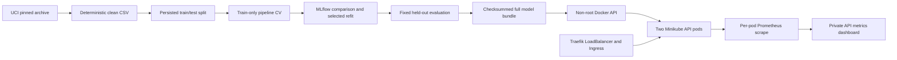

# Implemented architecture

The API performs validated inference using the same fitted preprocessing/model pipeline. Requests never train models. Metrics and logs describe service behavior; no online accuracy measurement or automatic retraining is claimed. CI trains/tests/packages before container testing. Local CD is a context-scoped script. Conditional GKE remains outside the current local implementation.
